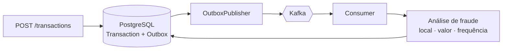

---

## 👋 Olá, eu sou o Luis

Vim do **recrutamento técnico** e hoje construo minha carreira em **engenharia de software backend**. Ter visto de perto o que os times de tecnologia procuram me faz escrever código pensando em quem vai ler, testar e manter.

- 🔭 Construindo sistemas com **Java, Spring Boot, PostgreSQL e Kafka**
- 🧱 Gosto de arquitetura orientada a eventos, APIs bem documentadas e testes
- 💬 Pergunte-me sobre backend, recrutamento técnico ou transição de carreira

---

## 🛠️ Stack

 

---

## 🚀 Projetos em destaque

### 🛡️ [fraud-monitoring-api](https://github.com/nando-sout/fraud-monitoring-api)

API que registra transações financeiras e classifica o risco de fraude **sem travar quem está pagando**: a transação é gravada na hora e a análise acontece de forma assíncrona.

- **Outbox Pattern:** a transação e o evento são gravados na mesma transação de banco, e um publisher envia ao Kafka
- **Regras de fraude:** localização, valor e frequência de transações
- **Infra:** Kafka em modo KRaft, PostgreSQL 16, migrations com Flyway, tudo subindo com Docker Compose
- **Documentação:** 14 documentos técnicos cobrindo arquitetura, trade-offs, testes e segurança

`Java 25` `Spring Boot` `Kafka` `PostgreSQL` `Flyway` `Docker` `OpenAPI`

---

### 📊 Recruiter Visual

Ferramenta para recruiters acompanharem **vagas, etapas e candidatos de forma visual**, com funil e Kanban. Nasceu da minha experiência com recrutamento: o foco é enxergar e movimentar candidatos, não ser um ATS completo.

| | Repositório | O que tem |
|---|---|---|
| 🎨 | [**recruiter-visual**](https://github.com/nando-sout/recruiter-visual) | Interface em React 19 e TypeScript, com funil da vaga, Kanban e gráficos |
| ⚙️ | [**recruiter-visual-api**](https://github.com/nando-sout/recruiter-visual-api) | API em Spring Boot com login JWT, verificação de e-mail, etapas configuráveis, avaliação por etapa e histórico de auditoria |

**Destaques da API:** cada recruiter só acessa as próprias vagas, senhas e códigos são guardados com hash, e a taxa de reprovação é calculada por etapa.

`React 19` `TypeScript` `Vite` `Tailwind CSS` `Spring Boot` `Spring Security` `JWT` `PostgreSQL`

---

## 🌱 Outros repositórios

| Repositório | Situação |
|---|---|
| [vollMed](https://github.com/nando-sout/vollMed) | Projeto de estudo com Spring Boot, em construção |
| [LuisFernando_TechRecruiter](https://github.com/nando-sout/LuisFernando_TechRecruiter) | Repositório de 2023, com o README inicial |

---

## 📊 Estatísticas

---

Feito com ☕ e Java

